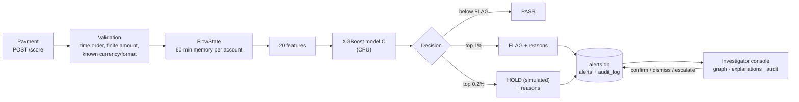

# MuleTrace

**Real-time money-mule ring detection on IBM LinuxONE. It scores each payment against the network it belongs to, not just the payment itself.**


> **Team Quorvex** · Yenepoya (Deemed to be University) · IBM Z Datathon 2026 · Track: *Real-Time AI for Critical Decisions* · Theme: Technology for Good

Every number below comes from a file in [`eval/`](eval/), produced on our LinuxONE VM (s390x, IBM z17 type 9175) on 2026-10-17.

<!-- results:start (generated by scripts/readme_results.py from eval/) -->
## TL;DR

- **Conservative headline (order-shuffled run): PR-AUC 0.137 vs 0.010** for a transaction-only model (13×), recall 42.2% vs 18.4%, about 1 in 21 flags is laundering. Standard run (upper bound): PR-AUC 0.219, recall 45.7%.
- **Why two numbers:** timestamps are per minute, so the order inside a minute is only file order. The shuffled run randomises that order before building features, so the model cannot benefit from it.
- **Time to detect:** **62.2%** of the 37 IBM-labelled laundering attempts that start in the test window get a FLAG/HOLD; median delay **0 min** from the attempt's first payment (p90 587 min) ([`eval/detection_delay.json`](eval/detection_delay.json), VERIFIED, pattern match 100%).
- **About 1.1 ms per decision on IBM z17** (in-process p50 1.10 ms, p99 4.06 ms over 20,000 payments; HTTP at 50 req/s for 30 s: 1,500 requests, 0 errors, server-side p99 4.35 ms). Data egress measured: 0 non-loopback connections of the API process in 75 socket samples while scoring 2,000 payments ([`eval/egress.json`](eval/egress.json)).

## Results

IBM AML HI-Small (synthetic), first 2,000,000 payments by time, split 60/20/20 by time. Test: 400,000 payments, 396 laundering. Thresholds from validation only.

**Conservative: order shuffled within each minute** ([`eval/report_shuf.md`](eval/report_shuf.md))

| Model | PR-AUC (95% CI) | Recall | Precision | Review | FP / 1,000 | P@100 |
|---|---|---:|---:|---:|---:|---:|
| A · Transaction-only XGBoost | 0.0104 (0.009–0.016) | 18.4% | 1.6% | 1.14% | 11.23 | 0.04 |
| B · Simple rules | 0.0014 (0.001–0.002) | 0.3% | 0.0% | 1.17% | 11.68 | 0.00 |
| N · Network features only | 0.0488 (0.032–0.079) | 16.7% | 2.1% | 0.80% | 7.87 | 0.28 |
| **C · MuleTrace (all 20 features)** | 0.1369 (0.104–0.186) | 42.2% | 4.8% | 0.87% | 8.31 | 0.47 |

**Standard run, upper bound** ([`eval/report.md`](eval/report.md))

| Model | PR-AUC (95% CI) | Recall | Precision | Review | FP / 1,000 | P@100 |
|---|---|---:|---:|---:|---:|---:|
| A · Transaction-only XGBoost | 0.0094 (0.008–0.012) | 19.4% | 1.6% | 1.18% | 11.62 | 0.01 |
| B · Simple rules | 0.0021 (0.002–0.002) | 0.3% | 0.0% | 1.17% | 11.68 | 0.00 |
| N · Network features only | 0.0686 (0.048–0.096) | 28.5% | 3.5% | 0.80% | 7.72 | 0.31 |
| **C · MuleTrace (all 20 features)** | 0.2188 (0.175–0.264) | 45.7% | 5.0% | 0.90% | 8.57 | 0.74 |

- Network signals carry the lift: in both runs, network-only beats transaction-only on PR-AUC (0.049 vs 0.010 conservative) and the combination beats both. In the conservative run, network-only recall (16.7%) is below transaction-only (18.4%).
- About 1 in 21 FLAGs is laundering (conservative run); the rest are false alarms, so a person decides. 57.8% of laundering payments are still missed at this review budget (conservative run).
<!-- results:end -->

## The problem

Mule accounts let criminals move stolen money, from scams, fraud and extortion, away from victims faster than banks can follow it. Each payment in a mule ring looks ordinary. Money fans in from many accounts, is passed on within minutes, and sometimes loops back. A model that sees one payment at a time sees an amount, a currency and a time, and misses the ring.

## Our approach

1. **Streaming flow memory.** `FlowState` keeps a rolling 60-minute window of money in and out per account. Each payment is scored *before* it is added, so features use only the past.
2. **Network signals.** 14 features cover fan-in, fan-out, bursts, pass-through ratio and lag, new accounts, and 2- and 3-account loops. There are also 6 transaction features.
3. **Recommendations, not actions.** XGBoost model C returns **PASS**, **FLAG** (top 1% of validation scores) or **HOLD** (top 0.2%). HOLD is a recommendation. **All financial actions are simulated.** No payment is actually held.
4. **Explanations on every flag.** Ring-pattern reasons come first, then the top 3 model signals from XGBoost `pred_contribs`, each with its real value. Example: *"Receiver got money from 36 different accounts in the last hour"*.
5. **A human decides, on the record.** Analysts confirm, dismiss or escalate. Every action is written to an append-only audit log with the analyst's name.

MuleTrace is designed to complement national mule-detection efforts such as RBIH's MuleHunter.AI, not to replace them.

## Architecture



### Limitations

- **Synthetic data.** Real-bank performance must be measured again on real data.
- **Order within a minute matters.** HI-Small timestamps are per minute; the conservative headline above removes any benefit from file order. A real stream has true arrival order.
- **Most laundering is still missed** at this review budget (see Results). Network memory is 60 minutes, so slower rings are out of scope.
- **One split, one seed.** The CIs come from a 200-sample bootstrap of the test set, not from retraining.
- **Demo-grade service.** Single process, in-memory state rebuilt at start-up (about 6 s), SQLite. Optional token auth. Intended to run behind an SSH tunnel.

## Why IBM Z

<!-- ibmz:start (generated by scripts/readme_results.py from eval/) -->
Source: [`eval/latency.json`](eval/latency.json), [`eval/environment.json`](eval/environment.json), [`eval/egress.json`](eval/egress.json). Measured on the VM: s390x, machine type 9175, 3 vCPU, 7.8 GiB RAM, Ubuntu 24.04.5 LTS, Python 3.12.3.

| Measurement | p50 | p95 | p99 |
|---|---:|---:|---:|
| In-process decision, 20,000 test payments | 1.10 ms | 1.59 ms | 4.06 ms |
| … FLAG/HOLD only (adds explanations and the alert write), 229 payments | 4.08 ms | 4.83 ms | 6.54 ms |
| HTTP `/score`, 50 req/s for 30 s (1,500 requests, 0 errors): server-side | 1.35 ms | 1.95 ms | 4.35 ms |
| … client round trip on the same machine | 2.42 ms | 3.36 ms | 5.71 ms |

- **Data stays put, measured:** 0 non-loopback connections of the API process in 75 socket samples while scoring 2,000 payments ([`eval/egress.json`](eval/egress.json)).
<!-- ibmz:end -->
- **On-chip AI is present but not used yet.** `/system` reports `nnpa: true` (Telum II). **Model C runs on the CPU.** On this VM, IBM Snap ML 1.17.2 printed "Falling back to CPU-only mode. IBM Snap ML will not leverage NNPA". We do not claim NNPA acceleration.
- **Feature build:** 2,000,000 payments in 50 s (one pass), peak memory 2.3 GB.
- Platform facts, s390x build notes and the Snap ML attempt (the model import fails; Snap ML runs CPU-only here): [docs/LINUXONE.md](docs/LINUXONE.md).

## API

FastAPI. Interactive schema at `/docs`. Write endpoints need the `X-MuleTrace-Token` header when `MULETRACE_TOKEN` is set. CORS is closed unless `MULETRACE_CORS` lists allowed origins.

| Method | Path | Purpose |
|---|---|---|
| GET | `/` | Investigator console |
| GET | `/health`, `/system`, `/stats`, `/metrics` | Liveness, platform facts, live counters, evaluation results |
| POST | `/score` | Score one payment → PASS/FLAG/HOLD, reasons, explanations, latency |
| GET | `/recent` | Last decisions (live feed) |
| GET | `/alerts`, `/alerts/{id}` | Alert queue and one case |
| POST | `/alerts/{id}/action` | `confirm` / `dismiss` / `escalate` / `open`, with `analyst` and `note` (simulated, audit-logged) |
| GET | `/alerts/{id}/audit` | Append-only history of a case |
| GET | `/graph/{account}` | Money flows in the last 60 minutes |
| POST | `/replay/start`, `/replay/stop` | Stream held-out test payments (one stream at a time) |

`/score` rejects these with 4xx: payments earlier than the stream time (409), more than 60 minutes ahead of it (422), a duplicate `txn_id` (409), a non-finite or non-positive amount, an unknown currency or format, and account IDs outside `[A-Za-z0-9_-]{1,64}`.

```bash
curl -s -X POST http://localhost:8000/score -H 'Content-Type: application/json' \
  -H "X-MuleTrace-Token: $MULETRACE_TOKEN" \
  -d '{"src": "070_1004286A8", "dst": "0021615_8036AE1C0", "amount": 8400, "fmt": "ACH"}'
```

The response includes `decision`, `score`, `reasons`, `explanations` (`feature`, `value`, `contribution`, `text`), `latency_ms`, `simulated: true` and `recommendation`.

## Reproduce

On Ubuntu 24.04 (the LinuxONE VM), from the repo root:

```bash
sudo apt-get install -y python3-venv python3-pandas python3-numpy python3-sklearn build-essential
python3 -m venv --system-site-packages ~/venv && source ~/venv/bin/activate
pip install fastapi==0.143.3 uvicorn==0.54.0 xgboost==3.4.1 httpx==0.28.1 kaggle   # see requirements.txt
kaggle datasets download -d ealtman2019/ibm-transactions-for-anti-money-laundering-aml -f HI-Small_Trans.csv -p data/

python data/prepare.py                 # first 2,000,000 payments by time, 60/20/20 split
python model/build_features.py         # ~50 s on the VM
python model/train.py                  # models/, eval/metrics.json, eval/report.{json,md}
python model/build_features.py shuffle && python model/train.py _shuf    # optional robustness check
python -m pytest -q tests              # 28 tests on synthetic fixtures, no dataset needed
python bench/latency.py inproc 20000   # eval/latency.json
```

### Run the console on the VM, open it from your laptop

```bash
# on the VM: stop old server, fresh alerts.db, uvicorn on 127.0.0.1:8000 in tmux "mt"; token in ~/.muletrace.env (outside the repo)
bash ~/muletrace/scripts/demo_start.sh --rotate-token
# on your laptop
ssh -i <your-key.pem> -N -L 8000:127.0.0.1:8000 linux1@<vm-ip>
# open http://localhost:8000/?token=<token>
```

The console has five pages: Live, Cases, Score, Evidence (read from `eval/`) and System. The 3-minute script, checklist and reset command are in [docs/DEMO.md](docs/DEMO.md). Screenshots from the browser smoke test (`tests/e2e/smoke.py`, Playwright, run against a fixture server on the VM) are in [docs/screenshots/](docs/screenshots/).


## Repository

```
api/main.py          FastAPI service: scoring, alerts, audit log, graph, replay
api/replay.py        CLI that streams test payments into /score
web/index.html       Investigator console (vis-network vendored in web/vendor/)
data/prepare.py      Time-sort, keep first N payments, 60/20/20 split
model/features.py    FlowState, 20 features, reasons, explanations, rule baseline
model/build_features.py, model/train.py    Feature pass and training/evaluation
bench/latency.py     Latency benchmark
tests/               Pipeline and API tests (synthetic fixtures); tests/e2e/ browser smoke test
eval/                Result files: metrics, report, shuffle check, latency, environment
docs/                AUDIT.md, DEMO.md, LINUXONE.md, api.md (outdated), screenshots/
scripts/             demo_start.sh, demo_reset.sh, readme_results.py
samples/             Responses recorded from the first model (before hardening)
```

## Responsible AI & AI use

- **Synthetic data only.** No real customers and no PII.
- **Recommendations only.** HOLD and all analyst actions are simulated. Every decision is audit-logged.
- **Explanations** come from the model's own per-feature contributions, not a generic score.
- **Ground truth** is stored only for evaluation and is never shown in the console or used for scoring.
- **AI tools:** built with help from Claude (Anthropic) for code review, hardening, tests and documentation. The team reviewed and ran everything.

## Data and third-party licences

- **Dataset:** "IBM Transactions for Anti Money Laundering (AML)", Erik Altman et al., IBM — [Kaggle](https://www.kaggle.com/datasets/ealtman2019/ibm-transactions-for-anti-money-laundering-aml), licensed under CDLA-Sharing-1.0. We use `HI-Small_Trans.csv`. The data is **synthetic** (generated by IBM's AMLworld simulator; no real customers). It is not redistributed in this repo.
- **vis-network 9.1.9** (vendored in `web/vendor/`): dual-licensed Apache-2.0 or MIT. Both texts are in `web/vendor/`.
- **Python packages:** FastAPI, Uvicorn, Pydantic, XGBoost, pandas, NumPy, scikit-learn, under their own open-source licences (see `requirements.txt`).

## How MuleTrace meets the judging criteria

- **Innovation & creativity:** each payment is scored against a 60-minute memory of the money moving around both accounts (fan-in, fast forwarding, 2- and 3-account loops), not in isolation. Every flag is explained by ring patterns plus the model's own per-signal contributions.
- **Technical implementation & complexity:** past-only streaming features, a time-based 60/20/20 split, thresholds from validation only, an ablation (A / network-only / C), bootstrap CIs and a within-minute shuffle robustness run. On top of that: a FastAPI service with token auth, validation, an append-only audit log, 29 automated tests and a browser end-to-end test.
- **Relevance & impact (AI for Good):** mule networks move scam victims' money within minutes. MuleTrace ranks and explains cases so investigators act faster. HOLD is a simulated recommendation, and a human decides.
- **Why IBM Z / LinuxONE:** measured on our VM (s390x, machine type 9175, 3 vCPU, 7.8 GiB; [`eval/environment.json`](eval/environment.json)). Decision latency is p50 1.10 ms and p99 4.06 ms over 20,000 payments. HTTP at 50 req/s: 1,500 requests, 0 errors ([`eval/latency.json`](eval/latency.json)). The data never leaves the machine: egress measured with `bench/egress_check.sh` (0 non-loopback connections, [`eval/egress.json`](eval/egress.json)). The NNPA on-chip accelerator is present but **not used**: the model runs on CPU ([docs/LINUXONE.md](docs/LINUXONE.md)).
- **Scalability & feasibility:** honestly, we have tested only up to 50 payments/s on 3 vCPUs, single process, with in-memory state. Higher rates are not measured. MuleTrace is an explainable investigation layer designed to complement existing bank fraud systems, not replace them.
- **Presentation:** a 3-minute demo script with checklist, reset and fallbacks is in [docs/DEMO.md](docs/DEMO.md). The console opens on an Overview page with a guided tour.

## Submission

- **Official submission:** demo + repository + project description + deck, via Hack2Skill, by **18 Oct 2026, 22:00 IST**.
- **Team size:** 4–6 members. We are 6 (see below).
- **Built during the event:** the git history starts with commit `21c7d85` on 2026-10-17 09:12 UTC (`git log --reverse | head`).

## 👥 Team

| # | Name | Role |
|---|---|---|
| M1 | Adib Sunasra | Team Lead, Product & Strategy, IBM LinuxONE Infrastructure & DevOps |
| M2 | Anshu Kumar Singh | AI/ML & Data Engineering |
| M3 | Abhishek Tiwari | Frontend & User Experience |
| M4 | Omez Khan | System Integration & Security |
| M5 | Aryan Nigam | Backend Development |
| M6 | Anant Mehta | QA, Security, Documentation & Demo |

## 🤝 Team Responsibilities

Our team collaborates across data engineering, AI/ML, frontend, backend, infrastructure, security, and testing to build MuleTrace, an explainable, real-time mule-account investigation platform running on IBM LinuxONE.

Each member owns a primary area of responsibility while contributing to system integration, validation, and the final demonstration.

## License

MIT. See [LICENSE](LICENSE). Copyright (c) 2026 Team Quorvex. Third-party components keep their own licences (see above).
