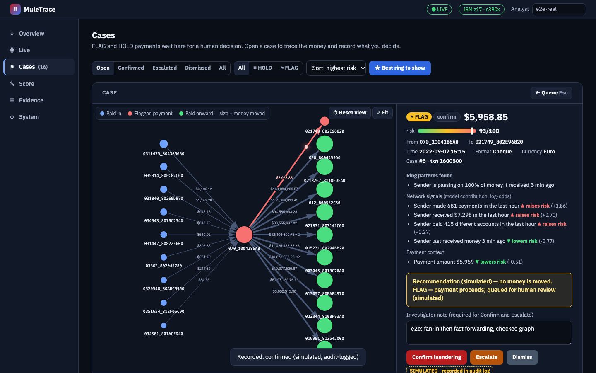
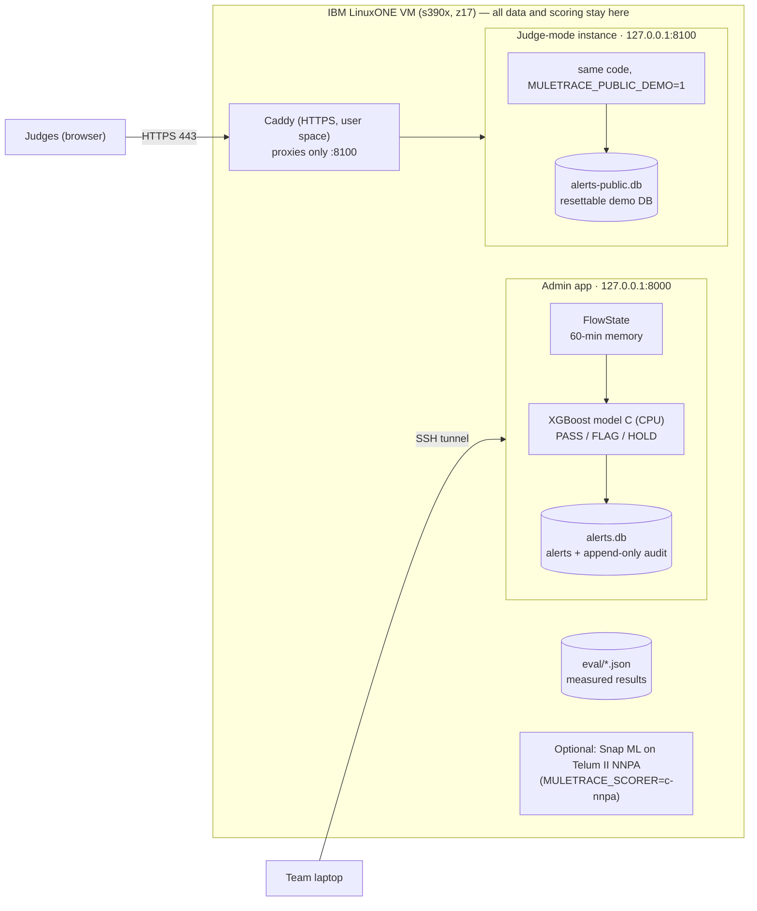

# MuleTrace

**MuleTrace finds money-mule rings as the money moves: it scores every payment against the last hour of money flowing around both accounts, explains why, and leaves the decision to a human investigator. It runs on IBM LinuxONE.**

> Team Quorvex · Yenepoya (Deemed to be University) · IBM Z Datathon 2026 · Track: *Real-Time AI for Critical Decisions* · Theme: Technology for Good

- **Live demo:** a public HTTPS judge demo runs on the LinuxONE VM (no login; synthetic data; actions simulated and reset periodically). The URL is given in the Hack2Skill submission. Team access to the admin app is through an SSH tunnel only.
- **Demo video:** *link to be added by the team*
- **Static demo (recorded data, clearly labelled MOCKED):** published only if GitHub Pages is enabled for this repo (see [Deployment](#deployment)).



Every number in this README is generated from files in [`eval/`](eval/) by `scripts/readme_results.py`, measured on our LinuxONE VM (s390x, IBM z17, machine type 9175). `python scripts/readme_results.py --check` fails if any of them drift.

<!-- results:start (generated by scripts/readme_results.py from eval/) -->
## TL;DR

- **Conservative headline (order-shuffled run): PR-AUC 0.137 vs 0.010** for a transaction-only model (13×), recall 42.2% vs 18.4%, about 1 in 21 flags is laundering. Standard run (upper bound): PR-AUC 0.219, recall 45.7%.
- **Why two numbers:** timestamps are per minute, so the order inside a minute is only file order. The shuffled run randomises that order before building features, so the model cannot benefit from it.
- **Time to detect:** **62.2%** of the 37 IBM-labelled laundering attempts that start in the test window get a FLAG/HOLD; median delay **0 min** from the attempt's first payment (p90 587 min) ([`eval/detection_delay.json`](eval/detection_delay.json), VERIFIED, pattern match 100%).
- **About 1.1 ms per decision on IBM z17** (in-process p50 1.10 ms, p99 4.06 ms over 20,000 payments; HTTP at 50 req/s for 30 s: 1,500 requests, 0 errors, server-side p99 4.35 ms). Data egress measured: 0 non-loopback connections of the API process in 75 socket samples while scoring 2,000 payments ([`eval/egress.json`](eval/egress.json)).

## Results

IBM AML HI-Small (synthetic), first 2,000,000 payments by time, split 60/20/20 by time. Test: 400,000 payments, 396 laundering. Thresholds from validation only.

**Conservative: order shuffled within each minute** ([`eval/report_shuf.md`](eval/report_shuf.md))

| Model | PR-AUC (95% CI) | Recall | Precision | Review | FP / 1,000 | P@100 |
|---|---|---:|---:|---:|---:|---:|
| A · Transaction-only XGBoost | 0.0104 (0.009–0.016) | 18.4% | 1.6% | 1.14% | 11.23 | 0.04 |
| B · Simple rules | 0.0014 (0.001–0.002) | 0.3% | 0.0% | 1.17% | 11.68 | 0.00 |
| N · Network features only | 0.0488 (0.032–0.079) | 16.7% | 2.1% | 0.80% | 7.87 | 0.28 |
| **C · MuleTrace (all 20 features)** | 0.1369 (0.104–0.186) | 42.2% | 4.8% | 0.87% | 8.31 | 0.47 |

**Standard run, upper bound** ([`eval/report.md`](eval/report.md))

| Model | PR-AUC (95% CI) | Recall | Precision | Review | FP / 1,000 | P@100 |
|---|---|---:|---:|---:|---:|---:|
| A · Transaction-only XGBoost | 0.0094 (0.008–0.012) | 19.4% | 1.6% | 1.18% | 11.62 | 0.01 |
| B · Simple rules | 0.0021 (0.002–0.002) | 0.3% | 0.0% | 1.17% | 11.68 | 0.00 |
| N · Network features only | 0.0686 (0.048–0.096) | 28.5% | 3.5% | 0.80% | 7.72 | 0.31 |
| **C · MuleTrace (all 20 features)** | 0.2188 (0.175–0.264) | 45.7% | 5.0% | 0.90% | 8.57 | 0.74 |

- Network signals carry the lift: in both runs, network-only beats transaction-only on PR-AUC (0.049 vs 0.010 conservative) and the combination beats both. In the conservative run, network-only recall (16.7%) is below transaction-only (18.4%).
- About 1 in 21 FLAGs is laundering (conservative run); the rest are false alarms, so a person decides. 57.8% of laundering payments are still missed at this review budget (conservative run).
<!-- results:end -->

## Problem

Mule accounts let criminals move stolen money (from scams, fraud and extortion) away from victims within minutes. Each payment in a mule ring looks ordinary: money fans in from many accounts, is passed on quickly, and sometimes loops back. A model that sees one payment at a time sees an amount, a currency and a time, and misses the ring.

## Solution

1. **Streaming flow memory.** `FlowState` keeps a rolling 60-minute window of money in and out per account. Each payment is scored *before* it is added, so features use only the past.
2. **Network signals.** 14 features describe fan-in, fan-out, bursts, pass-through ratio and lag, new accounts, and 2- and 3-account loops; 6 more describe the payment itself.
3. **Recommendations, not actions.** XGBoost model C returns **PASS**, **FLAG** (top 1% of validation scores) or **HOLD** (top 0.2%). **HOLD and every analyst action are simulated**: no payment is held, released or reported.
4. **Explanations.** Ring patterns first, then the model's own per-feature contributions (XGBoost `pred_contribs`), each marked "raises risk" or "lowers risk" and grouped into network signals and payment context.
5. **A human decides, on the record.** Confirm, escalate or dismiss, with a note; every action goes to an append-only audit log.

MuleTrace is an explainable investigation layer designed to **complement** existing fraud systems and national efforts such as RBIH's MuleHunter.AI, not to replace them. The data is **synthetic** (IBM AML HI-Small).

## Architecture



| Runs where | What |
|---|---|
| LinuxONE VM, 127.0.0.1:8000 | Admin app: scoring API, console, alerts DB, audit log. Reached only through an SSH tunnel. |
| LinuxONE VM, 127.0.0.1:8100 | Judge-mode instance (same code): public role, rate limits, own demo DB. |
| LinuxONE VM, :80/:443 | Caddy terminates HTTPS (Let's Encrypt) and proxies only to :8100; :80 redirects to HTTPS. |
| Browser | The single-file console (`web/index.html`), served by the API; fonts and vis-network vendored, so it works offline. |

## Features

- **Live replay** of 400,000 held-out payments in time order, with PASS/FLAG/HOLD, risk and server-side decision time. The feed pauses on hover.
- **Cases:** queue with status, decision and sort filters; **Best ring to show**; a money-flow graph (sender's payers → sender → receiver → receiver's payees) with click-to-expand, hover cards and a moving dot on the flagged payment; explanations; Confirm / Escalate / Dismiss with a note; audit timeline.
- **Score:** send one payment, with validation messages and an "Open case" link.
- **Evidence:** every metric read from `eval/`, with the conservative (order-shuffled) headline first.
- **System / Trust panel:** what is verified on this machine, what hardware is present but not used for the live model, and what is simulated.
- **Overview and a 60-second guided tour**, keyboard accessible (Lighthouse accessibility 100 on all six pages).

## IBM LinuxONE

<!-- ibmz:start (generated by scripts/readme_results.py from eval/) -->
Source: [`eval/latency.json`](eval/latency.json), [`eval/environment.json`](eval/environment.json), [`eval/egress.json`](eval/egress.json). Measured on the VM: s390x, machine type 9175, 3 vCPU, 7.8 GiB RAM, Ubuntu 24.04.5 LTS, Python 3.12.3.

| Measurement | p50 | p95 | p99 |
|---|---:|---:|---:|
| In-process decision, 20,000 test payments | 1.10 ms | 1.59 ms | 4.06 ms |
| … FLAG/HOLD only (adds explanations and the alert write), 229 payments | 4.08 ms | 4.83 ms | 6.54 ms |
| HTTP `/score`, 50 req/s for 30 s (1,500 requests, 0 errors): server-side | 1.35 ms | 1.95 ms | 4.35 ms |
| … client round trip on the same machine | 2.42 ms | 3.36 ms | 5.71 ms |

- **Data stays put, measured:** 0 non-loopback connections of the API process in 75 socket samples while scoring 2,000 payments ([`eval/egress.json`](eval/egress.json)).
- **Telum II on-chip AI (NNPA), measured as an optional path:** IBM Snap ML boosted trees on the same 20 features, run as zDNN tensors. Proof of NNPA use: Snap ML reports `zdnn_tensors`, zDNN 1.0.1 reports NNPA installed, and 9 zDNN functions (incl. `zdnn_matmul_op`) are called during predict. PR-AUC 0.2012 vs model C 0.2188, so **model C (CPU) stays live**. Latency p50 at batch 1 / 256: NNPA 0.028 / 3.84 ms, Snap ML CPU 0.011 / 0.89 ms, XGBoost CPU 0.123 / 1.66 ms: **no NNPA speed-up at these batch sizes** ([`eval/nnpa.json`](eval/nnpa.json)).
<!-- ibmz:end -->
- **Feature build:** 2,000,000 payments in 50 s (one pass), peak memory 2.3 GB.
- **s390x notes:** XGBoost 3.4.1 builds from source on s390x; numpy/pandas/scikit-learn come from Ubuntu packages; big-endian checked by a test (model JSON/UBJSON round trips give identical predictions). Details and the full NNPA story (what failed, how it was enabled without sudo, proof of use): [docs/LINUXONE.md](docs/LINUXONE.md).

## Security & privacy

- **Tokens and roles.** The admin token (`MULETRACE_TOKEN`, kept in `~/.muletrace.env` on the VM, never in the repo) is required for every read that exposes account data and for every write. In judge mode (`MULETRACE_PUBLIC_DEMO=1`), callers without a token get a limited **public** role: reads, replay at ≤ 100 payments/s, stop, analyst actions on the instance's own demo DB, and a demo reset at most every 10 minutes. Everything else returns 403.
- **Abuse limits.** Per-IP token buckets for non-admin callers (reads 15/s, burst 120; writes 1/s, burst 5), 16 KB request bodies, JSON-only POSTs (forces a CORS preflight), CORS closed unless configured.
- **Headers.** A CSP allowing only this origin and the page's own inline scripts by hash, `nosniff`, `no-referrer`, `X-Frame-Options: DENY`.
- **No secrets in logs.** uvicorn runs without access logs; Caddy logs drop the token, cookies and query token. The console removes `?token=` from the address bar after loading.
- **Egress measured.** 0 non-loopback connections of the API process while scoring 2,000 payments ([`eval/egress.json`](eval/egress.json)).
- **Simulated actions.** HOLD and analyst actions change nothing outside MuleTrace; ground-truth labels are stored only for evaluation and never shown.

## Prerequisites

- **Run the service:** Ubuntu 24.04 on IBM LinuxONE (tested) or any Linux/macOS with Python 3.10+ (tested 3.12.3), about 3 GB free RAM per instance.
- **Rebuild results:** the IBM AML HI-Small CSV from Kaggle (about 454 MB) and a Kaggle API token.
- **Browser tests (optional):** Playwright (`requirements-dev.txt`).

## Install

On the LinuxONE VM (Ubuntu 24.04, as used for every result here):

```bash
sudo apt-get install -y python3-venv python3-pandas python3-numpy python3-sklearn build-essential tmux
python3 -m venv --system-site-packages ~/venv && source ~/venv/bin/activate
pip install -r requirements.txt          # versions verified on s390x; xgboost builds from source here
git clone https://github.com/Adib-07/MULETRACE.git ~/muletrace && cd ~/muletrace
```

Locally (development, any OS): `python3 -m venv .venv && . .venv/bin/activate && pip install -r requirements.txt -r requirements-dev.txt`. On macOS, XGBoost also needs `brew install libomp`.

## Configuration

All settings are environment variables; none is a secret except the token, which lives only in `~/.muletrace.env` on the VM.

| Variable | Default | Purpose |
|---|---|---|
| `MULETRACE_TOKEN` | unset (no auth, local dev only) | Admin token; required for account data and writes |
| `MULETRACE_PUBLIC_DEMO` | `0` | `1` = judge mode (public role); refuses to start without `MULETRACE_TOKEN` |
| `MULETRACE_TRUST_PROXY` | `0` | `1` = take the client IP from `X-Forwarded-For` when the peer is localhost (behind Caddy) |
| `MULETRACE_SCORER` | `c` | `c-nnpa` = optional Snap ML scorer on NNPA (needs `SNAPML_ZDNN_LIB`, see LINUXONE.md) |
| `MULETRACE_CORS` | empty | Comma-separated allowed origins (closed by default) |
| `MULETRACE_DB` | `alerts.db` | SQLite file for alerts and the audit log |
| `MULETRACE_MODELS`, `MULETRACE_DATA`, `MULETRACE_EVAL`, `MULETRACE_WEB` | `models/`, `data/`, `eval/`, `web/` | Paths |
| `MULETRACE_LOG_LEVEL` | `INFO` | One structured log line per decision |
| `MULETRACE_HOST` | in `~/.muletrace-public.env` | Public hostname for Caddy (never committed) |

## One-command start

```bash
bash scripts/demo_start.sh                 # admin app on 127.0.0.1:8000 in tmux "mt", fresh alerts.db
bash scripts/demo_start.sh --keep-db       # restart keeping alerts and the audit log
bash scripts/demo_start.sh --rotate-token  # new admin token (old one stops working)
bash scripts/demo_reset.sh                 # empty queue, stream back at the start, same token
bash scripts/public_start.sh --app-only    # judge-mode instance on 127.0.0.1:8100 (no ports opened)
bash scripts/public_start.sh               # judge-mode instance + Caddy HTTPS (ports 80/443 must be open)
```

**URLs.** Development / team access: `http://localhost:8000` through an SSH tunnel (`ssh -N -L 8000:127.0.0.1:8000 <user>@<vm>`), then paste the token (read it on the VM with `cut -d= -f2 ~/.muletrace.env`). Public judge access: `https://<public-host>/` (no token needed; the host is `<dashed-public-ip>.sslip.io`, set in `~/.muletrace-public.env`).

## API

Interactive schema at `/docs`. `<TOKEN>` is the admin token; never paste it into shared places.

| Method | Path | Access | Purpose |
|---|---|---|---|
| GET | `/`, `/health`, `/system`, `/stats`, `/evidence`, `/metrics` | public | Console, liveness, platform facts, counters, eval files |
| POST | `/score` | admin | Score one payment → PASS/FLAG/HOLD, reasons, explanations, latency |
| GET | `/recent`, `/alerts`, `/alerts/{id}`, `/alerts/{id}/audit`, `/graph/{account}` | admin · public in judge mode | Live feed, case queue, one case, audit history, 60-min money flows |
| POST | `/alerts/{id}/action` | admin · public in judge mode | `confirm` / `dismiss` / `escalate` / `open` with `analyst` and `note` (simulated, audit-logged) |
| POST | `/replay/start`, `/replay/stop` | admin · public (≤ 100/s) | Stream held-out test payments, one stream at a time |
| POST | `/demo/reset` | judge mode only | Archive the demo DB and restart the stream (public: once per 10 min) |

```bash
curl -s http://localhost:8000/health
curl -s -H "X-MuleTrace-Token: <TOKEN>" "http://localhost:8000/alerts?limit=5&sort=risk"
curl -s -X POST http://localhost:8000/score -H 'Content-Type: application/json' -H "X-MuleTrace-Token: <TOKEN>" \
  -d '{"src": "070_1004286A8", "dst": "0021615_8036AE1C0", "amount": 8400, "fmt": "ACH"}'
```

`/score` returns 409 for a payment earlier than the stream or a duplicate `txn_id`, and 422 for one more than 60 minutes ahead, a non-finite or non-positive amount, an unknown currency/format or an invalid account ID.

## Tests

```bash
python -m pytest -q tests                                   # unit/API/pipeline/security tests, synthetic fixtures (no dataset needed)
python scripts/readme_results.py --check                    # README/UI numbers match eval/
python scripts/contrast_check.py                            # WCAG contrast of the palette and logo
python scripts/check_links.py                               # every README link resolves
# browser e2e against a running server (Playwright, requirements-dev.txt):
MULETRACE_URL=http://127.0.0.1:8000 MULETRACE_TOKEN=<TOKEN> python tests/e2e/e2e_real.py      # core workflow
MULETRACE_URL=http://127.0.0.1:8000 MULETRACE_TOKEN=<TOKEN> python tests/e2e/e2e_auth.py      # token flows, 401/200
MULETRACE_URL=http://127.0.0.1:8000 MULETRACE_TOKEN=<TOKEN> python tests/e2e/e2e_controls.py  # every control
MULETRACE_URL=http://127.0.0.1:8100 python tests/e2e/e2e_public.py                          # judge mode
```

## Reproduce the results

```bash
kaggle datasets download -d ealtman2019/ibm-transactions-for-anti-money-laundering-aml -f HI-Small_Trans.csv -p data/
python data/prepare.py                                  # first 2,000,000 payments by time, 60/20/20 split
python model/build_features.py && python model/train.py # eval/metrics.json, eval/report.{json,md}, models/
python model/build_features.py shuffle && python model/train.py _shuf   # conservative order-shuffled run
python bench/latency.py inproc 20000                    # eval/latency.json (+ "http 50 30" against a running server)
python bench/detection_delay.py                         # eval/detection_delay.json
bash bench/egress_check.sh                              # eval/egress.json (needs a running server)
python bench/nnpa_snapml.py                             # eval/nnpa.json (needs libzdnn; see LINUXONE.md)
python scripts/readme_results.py                        # regenerate the README numbers
```

## Dataset provenance

"IBM Transactions for Anti Money Laundering (AML)", Erik Altman et al., IBM — [Kaggle](https://www.kaggle.com/datasets/ealtman2019/ibm-transactions-for-anti-money-laundering-aml), licensed under **CDLA-Sharing-1.0** (as reported by the Kaggle CLI on our VM). We use `HI-Small_Trans.csv` and `HI-Small_Patterns.txt`. The data is **synthetic** (IBM's AMLworld simulator; no real customers) and is not redistributed in this repo.

## Deployment

**Admin app (VERIFIED):** runs on the LinuxONE VM at 127.0.0.1:8000 (tmux `mt`), reached only through an SSH tunnel. Health check on the VM: `curl -s 127.0.0.1:8000/health`.

**Public judge demo (VERIFIED from outside the VM):** `scripts/public_start.sh` runs a separate judge-mode instance on 127.0.0.1:8100 and Caddy (official v2.11.7 s390x binary, checksum-verified, in `~/bin`) with [`deploy/Caddyfile`](deploy/Caddyfile). Host firewall: TCP 22, 80 and 443 only. Checked from another network: valid Let's Encrypt certificate, HTTP→HTTPS redirect, `/health` 200, public role limits (403 for scoring and for replay above 100/s), 16 KB body cap, per-IP rate limit (burst → 429), ports 8000/8100 closed. Access logs contain no query strings, tokens or cookies. Restart recovery: killing the app and Caddy and running `scripts/public_start.sh` brings the URL back.

**Static fallback:** with GitHub Pages enabled (repo **Settings → Pages → Deploy from a branch → `main` / root**), the console works at `https://<owner>.github.io/MULETRACE/web/` in a clearly labelled **MOCKED** mode that reads the recorded `eval/` files. It is never presented as live.

**Troubleshooting**

| Symptom | Fix |
|---|---|
| Console says OFFLINE | The SSH tunnel dropped: re-run the `ssh -N -L 8000:...` command. |
| "Token rejected — it may have been rotated" | Read the current token on the VM: `cut -d= -f2 ~/.muletrace.env`. |
| Stream won't start (409) | All test payments were replayed: `bash scripts/demo_reset.sh`. |
| Best ring says no flows | Run the stream for about 20 s, stop it, press Best ring again. |
| `/health` fails after a VM reboot | `bash scripts/demo_start.sh --keep-db` (auto-start on reboot is prepared in `scripts/autostart.sh`, not applied). |

## How MuleTrace meets the judging criteria

- **Innovation & creativity:** every payment is scored against a 60-minute memory of the money around both accounts (fan-in, fast forwarding, 2- and 3-account loops), and every flag is explained by ring patterns plus the model's own per-signal contributions.
- **Technical implementation & complexity:** past-only streaming features, time-based split, thresholds from validation only, ablation, bootstrap CIs, a within-minute shuffle robustness run, time-to-detect on IBM-labelled attempts; a FastAPI service with roles, rate limits, an append-only audit log, unit tests and browser end-to-end tests.
- **Relevance & impact (AI for Good):** mule networks move scam victims' money within minutes; MuleTrace shows investigators the riskiest rings first with the reasons (time saved is not measured). HOLD is a simulated recommendation and a human decides.
- **Why IBM Z / LinuxONE:** measured on our VM (s390x, machine type 9175, 3 vCPU, 7.8 GiB): decision latency p50 1.10 ms and p99 4.06 ms over 20,000 payments; HTTP at 50 req/s: 1,500 requests, 0 errors; data egress measured at 0 non-loopback connections; NNPA measured as an optional path (not faster, not the live model).
- **Scalability & feasibility:** tested only up to 50 payments/s on 3 vCPUs, single process; higher rates are not measured. Designed to complement existing fraud systems.
- **Presentation:** 3-minute demo script with checklist and fallbacks in [docs/DEMO.md](docs/DEMO.md); the console opens on an Overview with a guided tour.

## Limitations

- **Synthetic data.** Performance on real bank data must be measured again.
- **Order within a minute matters.** HI-Small timestamps are per minute; the conservative headline removes any benefit from file order. A real stream has true arrival order.
- **Most laundering is still missed** at this review budget, and about 1 in 20 flags is laundering. Network memory is 60 minutes, so slower rings are out of scope.
- **One split, one seed.** The CIs come from a 200-sample bootstrap of the test set, not from retraining.
- **Scale tested only to 50 payments/s** on 3 vCPUs, single process, in-memory state rebuilt at start-up (about 6 s), SQLite.
- **NNPA** is a measured optional path, slightly less accurate and not faster at batch 1/256; the live model runs on CPU.
- **One shared admin token**; analyst names are self-declared (recorded, not authenticated).

## Team

| # | Name | Role |
|---|---|---|
| M1 | Adib Sunasra | Team Lead, Product & Strategy, IBM LinuxONE Infrastructure & DevOps |
| M2 | Anshu Kumar Singh | AI/ML & Data Engineering |
| M3 | Abhishek Tiwari | Frontend & User Experience |
| M4 | Omez Khan | System Integration & Security |
| M5 | Aryan Nigam | Backend Development |
| M6 | Anant Mehta | QA, Security, Documentation & Demo |

### Team responsibilities

Our team collaborates across data engineering, AI/ML, frontend, backend, infrastructure, security, and testing to build MuleTrace, an explainable, real-time mule-account investigation platform running on IBM LinuxONE.

Each member owns a primary area of responsibility while contributing to system integration, validation, and the final demonstration.


## Licences

- **MuleTrace:** MIT, see [LICENSE](LICENSE). Copyright (c) 2026 Team Quorvex.
- **vis-network 9.1.9** (vendored): Apache-2.0 or MIT, texts in [`web/vendor/`](web/vendor/).
- **IBM Plex Sans/Mono** (vendored): SIL Open Font License 1.1, [`web/vendor/fonts/OFL-IBM-Plex.txt`](web/vendor/fonts/OFL-IBM-Plex.txt).
- **Caddy** (deployment, not in the repo): Apache-2.0.
- **Python packages:** FastAPI, Uvicorn, Pydantic, XGBoost, pandas, NumPy, scikit-learn, Snap ML (optional), under their own licences (see `requirements*.txt`).
- **Dataset:** CDLA-Sharing-1.0 (see Dataset provenance).

## AI-use disclosure

Built with help from **Claude (Anthropic)** for code review, hardening, tests, evaluation tooling and documentation. The team reviewed, ran and decided on everything; all results come from runs on our LinuxONE VM.
