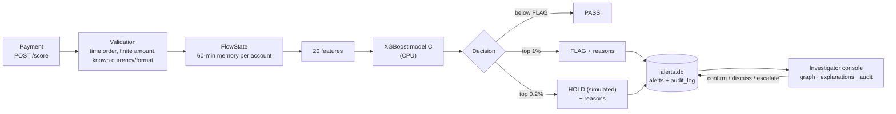

# MuleTrace

**Real-time money-mule ring detection on IBM LinuxONE. It scores each payment against the network it belongs to, not just the payment itself.**


> IBM Z Datathon 2026 · Track: *Real-Time AI for Critical Decisions* · Theme: Technology for Good · NIAT Yenepoya.

Every number below comes from a file in [`eval/`](eval/), produced on our LinuxONE VM (s390x, IBM z17 type 9175) on 2026-10-17.

## TL;DR

- **23× better ranking than a transaction-only model.** PR-AUC 0.2188 (95% CI 0.175–0.264) vs 0.0094 on 400,000 unseen test payments.
- **More laundering caught with fewer reviews.** 45.7% recall at a 0.90% review rate, against 19.4% at 1.18%. Of the 100 highest-scored test payments, 74 are laundering.
- **About 1.1 ms per decision on IBM z17.** In-process p50 1.10 ms and p99 4.06 ms over 20,000 payments. Over HTTP at 50 req/s for 30 s: 0 errors, server-side p99 4.35 ms.

## The problem

Mule accounts let criminals move stolen money, from scams, fraud and extortion, away from victims faster than banks can follow it. Each payment in a mule ring looks ordinary. Money fans in from many accounts, is passed on within minutes, and sometimes loops back. A model that sees one payment at a time sees an amount, a currency and a time, and misses the ring.

## Our approach

1. **Streaming flow memory.** `FlowState` keeps a rolling 60-minute window of money in and out per account. Each payment is scored *before* it is added, so features use only the past.
2. **Network signals.** 14 features cover fan-in, fan-out, bursts, pass-through ratio and lag, new accounts, and 2- and 3-account loops. There are also 6 transaction features.
3. **Recommendations, not actions.** XGBoost model C returns **PASS**, **FLAG** (top 1% of validation scores) or **HOLD** (top 0.2%). HOLD is a recommendation. **All financial actions are simulated.** No payment is actually held.
4. **Explanations on every flag.** Ring-pattern reasons come first, then the top 3 model signals from XGBoost `pred_contribs`, each with its real value. Example: *"Receiver got money from 36 different accounts in the last hour"*.
5. **A human decides, on the record.** Analysts confirm, dismiss or escalate. Every action is written to an append-only audit log with the analyst's name.

MuleTrace is designed to complement national mule-detection efforts such as RBIH's MuleHunter.AI, not to replace them.

## Architecture



## Results

Data: IBM AML HI-Small (synthetic), the first 2,000,000 payments by time, split 60/20/20 by time. The test set is 400,000 payments, 396 of them laundering. Thresholds come from validation only. Source: [`eval/report.md`](eval/report.md) and [`eval/metrics.json`](eval/metrics.json).

| Model | PR-AUC (95% CI) | Recall | Precision | Review | FP / 1,000 | Precision@100 |
|---|---|---:|---:|---:|---:|---:|
| A · Transaction-only XGBoost | 0.0094 (0.0078–0.0120) | 19.4% | 1.6% | 1.18% | 11.62 | 0.01 |
| B · Simple rules | 0.0021 (0.0018–0.0024) | 0.3% | 0.0% | 1.17% | 11.68 | 0.00 |
| N · Network features only (ablation) | 0.0686 (0.0475–0.0963) | 28.5% | 3.5% | 0.80% | 7.72 | 0.31 |
| **C · MuleTrace (all 20 features)** | **0.2188 (0.1753–0.2643)** | **45.7%** | **5.0%** | **0.90%** | **8.57** | **0.74** |

- **Network signals carry the lift.** Network features alone beat transaction features alone by 7× PR-AUC. Combined, they beat either one.
- **Precision, stated plainly.** About **1 in 20** FLAGs is laundering (181 of 3,611 on test). For HOLD it's about 1 in 6 (120 of 683). The rest are false alarms. That's why a person decides.
- **Per test day:** 2022-09-02 PR-AUC 0.121 with recall 39.4% (142 laundering). 2022-09-03 PR-AUC 0.313 with recall 49.2% (254 laundering).
- **Retrained after a determinism fix** (`cycle3` order): the metrics are identical to the first model's.

### Limitations

- **Synthetic data.** Real-bank performance must be measured again on real data.
- **Order within a minute matters.** HI-Small timestamps are per minute, so the order within a minute is file order. With that order shuffled ([`eval/report_shuf.md`](eval/report_shuf.md)), C drops to PR-AUC 0.1369 (95% CI 0.104–0.186), recall 42.2%, precision 4.8%. It still beats A (0.0104) by 13×, but part of the headline result depends on file order. A real stream has true arrival order.
- **Most laundering is still missed** at this budget (54% on test). Network memory is 60 minutes, so slower rings are out of scope.
- **One split, one seed.** The CIs come from a 200-sample bootstrap of the test set, not from retraining.
- **Demo-grade service.** Single process, in-memory state rebuilt at start-up (about 6 s), SQLite. Optional token auth. Intended to run behind an SSH tunnel.

## Why IBM Z

Source: [`eval/latency.json`](eval/latency.json) and [`eval/environment.json`](eval/environment.json). Measured on the VM: s390x, z17 type 9175, 3 vCPU, 7.8 GiB RAM, Ubuntu 24.04.5, Python 3.12.3.

| Measurement | p50 | p95 | p99 |
|---|---:|---:|---:|
| In-process decision, 20,000 test payments | 1.10 ms | 1.59 ms | 4.06 ms |
| … FLAG/HOLD only (adds explanations and the alert write), 229 payments | 4.08 ms | 4.83 ms | 6.54 ms |
| HTTP `/score`, 50 req/s for 30 s (1,500 requests, 0 errors): server-side | 1.35 ms | 1.95 ms | 4.35 ms |
| … client round trip on the same machine | 2.42 ms | 3.36 ms | 5.71 ms |

- **Data stays put.** Scoring, flow memory and alerts run on one machine, and the API makes no outbound calls.
- **On-chip AI is present but not used yet.** `/system` reports `nnpa: true` (Telum II). **Model C runs on the CPU.** On this VM, IBM Snap ML 1.17.2 printed "Falling back to CPU-only mode. IBM Snap ML will not leverage NNPA". We do not claim NNPA acceleration.
- **Feature build:** 2,000,000 payments in 50 s (one pass), peak memory 2.3 GB.

## API

FastAPI. Interactive schema at `/docs`. Write endpoints need the `X-MuleTrace-Token` header when `MULETRACE_TOKEN` is set. CORS is closed unless `MULETRACE_CORS` lists allowed origins.

| Method | Path | Purpose |
|---|---|---|
| GET | `/` | Investigator console |
| GET | `/health`, `/system`, `/stats`, `/metrics` | Liveness, platform facts, live counters, evaluation results |
| POST | `/score` | Score one payment → PASS/FLAG/HOLD, reasons, explanations, latency |
| GET | `/recent` | Last decisions (live feed) |
| GET | `/alerts`, `/alerts/{id}` | Alert queue and one case |
| POST | `/alerts/{id}/action` | `confirm` / `dismiss` / `escalate` / `open`, with `analyst` and `note` (simulated, audit-logged) |
| GET | `/alerts/{id}/audit` | Append-only history of a case |
| GET | `/graph/{account}` | Money flows in the last 60 minutes |
| POST | `/replay/start`, `/replay/stop` | Stream held-out test payments (one stream at a time) |

`/score` rejects these with 4xx: payments earlier than the stream time (409), more than 60 minutes ahead of it (422), a duplicate `txn_id` (409), a non-finite or non-positive amount, an unknown currency or format, and account IDs outside `[A-Za-z0-9_-]{1,64}`.

```bash
curl -s -X POST http://localhost:8000/score -H 'Content-Type: application/json' \
  -H "X-MuleTrace-Token: $MULETRACE_TOKEN" \
  -d '{"src": "070_1004286A8", "dst": "0021615_8036AE1C0", "amount": 8400, "fmt": "ACH"}'
```

The response includes `decision`, `score`, `reasons`, `explanations` (`feature`, `value`, `contribution`, `text`), `latency_ms`, `simulated: true` and `recommendation`.

## Reproduce

On Ubuntu 24.04 (the LinuxONE VM), from the repo root:

```bash
sudo apt-get install -y python3-venv python3-pandas python3-numpy python3-sklearn build-essential
python3 -m venv --system-site-packages ~/venv && source ~/venv/bin/activate
pip install fastapi==0.143.3 uvicorn==0.54.0 xgboost==3.4.1 httpx==0.28.1 kaggle   # see requirements.txt
kaggle datasets download -d ealtman2019/ibm-transactions-for-anti-money-laundering-aml -f HI-Small_Trans.csv -p data/

python data/prepare.py                 # first 2,000,000 payments by time, 60/20/20 split
python model/build_features.py         # ~50 s on the VM
python model/train.py                  # models/, eval/metrics.json, eval/report.{json,md}
python model/build_features.py shuffle && python model/train.py _shuf    # optional robustness check
python -m pytest -q tests              # 28 tests on synthetic fixtures, no dataset needed
python bench/latency.py inproc 20000   # eval/latency.json
```

### Run the console on the VM, open it from your laptop

```bash
# on the VM (binds to 127.0.0.1 only; the token protects write endpoints)
MULETRACE_TOKEN=$(cat ~/.muletrace_token) python -m uvicorn api.main:app --host 127.0.0.1 --port 8000
# on your laptop
ssh -i <your-key.pem> -N -L 8000:127.0.0.1:8000 linux1@<vm-ip>
# open http://localhost:8000/?token=<token>
```

The console has five pages: Live, Cases, Score, Evidence (read from `eval/`) and System. The 3-minute script, checklist and reset command are in [docs/DEMO.md](docs/DEMO.md). Screenshots from the browser smoke test (`tests/e2e/smoke.py`, Playwright, run against a fixture server on the VM) are in [docs/screenshots/](docs/screenshots/).


## Repository

```
api/main.py          FastAPI service: scoring, alerts, audit log, graph, replay
api/replay.py        CLI that streams test payments into /score
web/index.html       Investigator console (vis-network vendored in web/vendor/)
data/prepare.py      Time-sort, keep first N payments, 60/20/20 split
model/features.py    FlowState, 20 features, reasons, explanations, rule baseline
model/build_features.py, model/train.py    Feature pass and training/evaluation
bench/latency.py     Latency benchmark
tests/               Pipeline and API tests (synthetic fixtures); tests/e2e/ browser smoke test
eval/                Result files: metrics, report, shuffle check, latency, environment
docs/                AUDIT.md, DEMO.md, api.md (outdated), screenshots/
samples/             Responses recorded from the first model (before hardening)
```

## Responsible AI & AI use

- **Synthetic data only.** No real customers and no PII.
- **Recommendations only.** HOLD and all analyst actions are simulated. Every decision is audit-logged.
- **Explanations** come from the model's own per-feature contributions, not a generic score.
- **Ground truth** is stored only for evaluation and is never shown in the console or used for scoring.
- **AI tools:** built with help from Claude (Anthropic) for code review, hardening, tests and documentation. The team reviewed and ran everything.

## Data and third-party licences

- **Dataset:** *IBM Transactions for Anti Money Laundering (AML)* by E. Altman et al., [Kaggle](https://www.kaggle.com/datasets/ealtman2019/ibm-transactions-for-anti-money-laundering-aml). File: `HI-Small_Trans.csv`. Licence as reported by the Kaggle CLI during download on our VM: "Community Data License Agreement - Sharing - Version 1.0". The data is not redistributed in this repo. Please check the licence terms on the Kaggle page yourself.
- **vis-network 9.1.9** (vendored in `web/vendor/`): dual-licensed Apache-2.0 or MIT. Both texts are in `web/vendor/`.
- **Python packages:** FastAPI, Uvicorn, Pydantic, XGBoost, pandas, NumPy, scikit-learn, under their own open-source licences (see `requirements.txt`).

## Before submitting: verify manually

We could not read the official Datathon rules from this environment, so none of these are claimed:
- the deadline and submission portal
- the required deliverables (repo, deck, video) and the video length limit
- team-size rules
- the rules on originality and AI-tool use
- whether a licence must be chosen

## Team

| # | Name | Role |
|---|---|---|
| M1 | Adib Sunasra | Team Lead, Product & Strategy, IBM LinuxONE Infrastructure & DevOps |
| M2 | Anshu Kumar Singh | AI/ML & Data Engineering |
| M3 | Abhishek Tiwari | Frontend & User Experience |
| M4 | Omez Khan | System Integration & Security |
| M5 | Aryan Nigam | Backend Development |
| M6 | Anant Mehta | QA, Security, Documentation & Demo |

Our team collaborates across data engineering, AI/ML, frontend, backend, infrastructure, security, and testing to build MuleTrace, an explainable, real-time mule-account investigation platform running on IBM LinuxONE. Each member owns a primary area of responsibility while contributing to system integration, validation, and the final demonstration.

## License

To be chosen by the team before submission.
