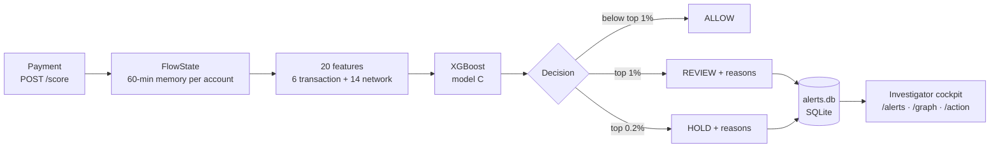

# MuleTrace

**Real-time money-mule ring detection on IBM LinuxONE: it scores each payment against the network it belongs to, not just the payment itself.**


> IBM Z Datathon 2026 · Track: *Real-Time AI for Critical Decisions* · Team of six first-year B.Tech students, NIAT Yenepoya.

---

## TL;DR

- **23× better ranking than a transaction-only model.** PR-AUC 0.2188 vs 0.0094 on 400,000 unseen test payments.
- **More than twice the laundering caught, with fewer reviews.** 45.7% recall at a 0.90% review rate, against 19.4% at 1.18%. False positives drop from 11.62 to 8.57 per 1,000 payments.
- **Live on an IBM z17 (s390x).** 1.52 ms average server-side decision over 3,000 replayed payments, with plain-English reasons on every flag.

---

## The problem

Mule rings exist to make each payment look ordinary. Money is split into small amounts. It fans in from many accounts to one, fans out again, and moves on within minutes. Sometimes it loops back to where it started.

A per-transaction model sees one row: amount, currency, format, hour. Those signals carry almost no information about laundering. Our transaction-only baseline (model A) shows this. Same algorithm, same training budget, and it finds 19.4% of laundering payments while only 1 in 60 of its flags is real.

The signal is in the *flow*. Who paid this receiver in the last hour? Is the sender passing on money it just received? Does the money come back? To answer those questions you need memory of recent payments, and you need it at decision time.

## Our approach

1. **Streaming flow memory.** `FlowState` keeps a rolling 60-minute window of money in and money out for every account. It also remembers every account and sender→receiver pair it has seen. Each payment is scored *before* it is added, so features only ever use the past.
2. **Network signals.** Fourteen features describe the neighbourhood: fan-in, fan-out, bursts, pass-through ratio and lag, new accounts, and 2- and 3-account loops.
3. **One gradient-boosted model.** XGBoost on 6 transaction features + 14 network features (model C). Thresholds come from the validation set: **REVIEW** for the top 1% of scores, **HOLD** for the top 0.2%, **ALLOW** for the rest.
4. **Explainable decisions.** Every REVIEW or HOLD carries up to four reasons in plain English, for example *"Receiver got money from 7 different accounts in the last hour"*.
5. **Human in the loop.** Flags go to an alert queue. An investigator confirms, dismisses or escalates each one. MuleTrace ranks and explains. A person decides.

## Architecture



When the service starts, it replays the train and validation history into `FlowState`. Live scoring then continues the same stream. Access to the shared state is serialised with a lock. The cockpit is API-only today; a UI is on the roadmap.

## Feature catalogue

All features come from [`model/features.py`](model/features.py). "Last hour" means the 60-minute window before the payment.

| Feature | Group | Plain meaning |
|---|---|---|
| `log_amt` | Transaction | Log of the amount paid |
| `self_txn` | Transaction | Sender and receiver are the same account |
| `cross_cur` | Transaction | Currency paid differs from currency received |
| `fmt` | Transaction | Payment format (ACH, Bitcoin, Cash, Cheque, Credit Card, Reinvestment, Wire) |
| `hour` | Transaction | Hour of day |
| `round_amt` | Transaction | Whole-number amount of 100 or more |
| `dst_in_senders` | Network | Distinct accounts that paid the receiver in the last hour |
| `dst_in_count` | Network | Payments into the receiver in the last hour |
| `dst_burst_10m` | Network | Payments into the receiver in the last 10 minutes |
| `dst_in_amt_log` | Network | Log of total money into the receiver in the last hour |
| `src_out_receivers` | Network | Distinct accounts the sender paid in the last hour |
| `src_out_count` | Network | Payments sent by the sender in the last hour |
| `src_in_amt_log` | Network | Log of total money into the sender in the last hour |
| `fwd_ratio` | Network | Sender's outflow (including this payment) ÷ its inflow in the last hour, capped at 50 |
| `fwd_lag` | Network | Minutes since the sender last received money (capped at 1,440) |
| `src_first_seen` | Network | Sender has never appeared before |
| `dst_first_seen` | Network | Receiver has never appeared before |
| `pair_seen` | Network | This sender has paid this receiver before |
| `cycle2` | Network | Receiver paid the sender in the last hour (A → B → A) |
| `cycle3` | Network | One of the receiver's recent payees paid the sender (A → B → C → A); checks up to 20 payees |

Baseline B (`rule_score`) is a hand-weighted mix of fan-in, pass-through, fan-out and loops. It uses no machine learning.

## Results

Test set: **400,000 payments** the models never saw. Review budget: about 1%. Each threshold is set to the 99th percentile of that model's **validation** scores, then applied unchanged to test. Source: [`eval/metrics.json`](eval/metrics.json).

| Model | PR-AUC | Recall | Precision | Review rate | FP / 1,000 payments |
|---|---:|---:|---:|---:|---:|
| A · Transaction-only XGBoost | 0.0094 | 19.4% | 1.6% | 1.18% | 11.62 |
| B · Simple rules | 0.0021 | 0.3% | 0.0% | 1.17% | 11.68 |
| **C · MuleTrace network model** | **0.2188** | **45.7%** | **5.0%** | **0.90%** | **8.57** |

**Takeaways**

- **Network context is the signal.** A and C share the algorithm, hyperparameters and training sample. The only difference is the 14 network features. PR-AUC rises 23×.
- **Better on both sides of the ledger.** C catches 2.4× more laundering while sending fewer payments to review.
- **Hand-written rules do not transfer.** Intuitive thresholds on the same network features catch almost nothing. The model learns the combinations that matter.
- **Precision, stated plainly.** About **1 in 20** of C's flags is laundering, against about **1 in 60** for A. That is a 3× better use of investigator time. It also means 19 of 20 flags are legitimate. That is why MuleTrace queues payments for review and never acts alone.

### Evaluation methodology

- **Data.** IBM AML HI-Small (synthetic). Sorted by timestamp; the first 2,000,000 payments kept.
- **Split.** Time-based 60/20/20: train 1,200,000, validation 400,000, test 400,000. No shuffling.
- **No future leakage.** Features are built in one pass over train → validation → test. Each payment is scored before it enters `FlowState`. Labels are never used to build features.
- **Training.** All laundering payments from train, plus 200,000 sampled normal payments, with `scale_pos_weight` for balance. XGBoost, 300 trees, depth 6, learning rate 0.1.
- **Metrics.** PR-AUC (average precision), recall, precision, share of payments sent to review, and false positives per 1,000 payments.

### Limitations

- **Synthetic data.** HI-Small is a simulation. Real-bank performance will differ and must be re-measured.
- **One run.** One seed, one split. No confidence intervals yet.
- **Threshold drift.** A 1% threshold from validation produced 0.90% reviews on test. Thresholds need monitoring in production.
- **Small windows vary.** In the 3,000-payment replay ([`samples/alerts.json`](samples/alerts.json)), 1 of 28 alerts was laundering. Precision over the full test set is 5.0%.
- **Short memory.** Network features look back 60 minutes. Slower rings are out of scope for now.
- **Demo-grade service.** Single process, in-memory state, SQLite alerts, no authentication, open CORS. Run it behind an SSH tunnel, as shown below.

## Why IBM Z

| Need | What MuleTrace shows on LinuxONE |
|---|---|
| **Latency** | 1.52 ms average server-side decision across 3,000 replayed payments ([`samples/stats.json`](samples/stats.json)). Fast enough to sit inline before settlement. |
| **Data residency** | Scoring, flow state and alerts all live on the same machine. The API makes no outbound calls. |
| **On-chip AI** | The z17's Telum II processor has an on-chip AI accelerator (NNPA). `/system` confirms it is present. |

Live output from `GET /system` on our VM ([`samples/system.json`](samples/system.json)):

```json
{
  "arch": "s390x",
  "byteorder": "big",
  "python": "3.12.3",
  "nnpa": true,
  "machine_type": "9175",
  "data_egress": "none"
}
```

`9175` is the IBM z17 machine type. `nnpa` is read from `/proc/cpuinfo`. `data_egress` is a declared property of the service, not a measurement. VM: 3 vCPU, 8 GB RAM, Ubuntu 24.04. The full 2,000,000-payment feature build takes about 45 seconds on this VM.

> **Honest status:** model C currently runs on the **CPU**. NNPA acceleration is our next step (see Roadmap). We do not claim it today.

## API reference

The service lives in [`api/main.py`](api/main.py).

| Method | Path | Purpose |
|---|---|---|
| `GET` | `/health` | Liveness check |
| `GET` | `/system` | Platform proof: architecture, byte order, Python version, NNPA flag, machine type |
| `POST` | `/score` | Score one payment and return ALLOW / REVIEW / HOLD with reasons and latency |
| `GET` | `/alerts?limit=50&status=open` | Alert queue, highest score first |
| `POST` | `/alerts/{id}/action` | Investigator action: `{"action": "confirm" \| "dismiss" \| "escalate"}` |
| `GET` | `/graph/{account}` | The account's in-memory money flows as nodes and edges, for visualisation |
| `GET` | `/stats` | Payments scored, REVIEW and HOLD counts, average latency |

`/score` body fields: `ts`, `src`, `dst` and `amount` are required. `txn_id`, `currency` and `cur_recv` (default `US Dollar`), `fmt` (default `ACH`) and `label` are optional. `label` is stored with the alert for evaluation only. The model never sees it.

```bash
curl -s -X POST http://localhost:8000/score \
  -H 'Content-Type: application/json' \
  -d '{"txn_id": "1602413", "ts": "2022-09-02 15:19:00",
       "src": "021745_803366440", "dst": "0021615_8036AE1C0",
       "amount": 43038.53}'
```

```jsonc
{
  "txn_id": "1602413",
  "score": 0.993,
  "decision": "HOLD",
  "reasons": ["Sender is passing on 100% of money it received 0 min ago"],
  "latency_ms": 1.52  // varies per call; 1.52 is the replay average
}
```

This decision was recorded during the replay (alert 25 in `samples/alerts.json`, a true laundering payment). Scores depend on the flow state built from earlier payments. A standalone call on a fresh server will return a different score.

## Quickstart

Requires Python 3.10+ (tested on 3.12) and a [Kaggle API token](https://www.kaggle.com/docs/api) in `~/.kaggle/kaggle.json`. Run every command from the repo root.

```bash
# 1. Environment
python3 -m venv .venv && source .venv/bin/activate
pip install pandas scikit-learn xgboost fastapi uvicorn kaggle

# 2. Data: IBM AML HI-Small transactions
kaggle datasets download -d ealtman2019/ibm-transactions-for-anti-money-laundering-aml \
  -f HI-Small_Trans.csv -p data/
unzip -o data/HI-Small_Trans.csv.zip -d data/   # only if Kaggle delivered a .zip

# 3. Time-sort, keep the first 2,000,000 payments, split 60/20/20
python data/prepare.py

# 4. Stream all payments through FlowState
python model/build_features.py

# 5. Train A and C, evaluate A/B/C, write models/ and eval/metrics.json
python model/train.py

# 6. Start the API (it loads train + validation history before serving)
uvicorn api.main:app --host 127.0.0.1 --port 8000

# 7. In a second terminal: replay 3,000 test payments at 50 per second
python api/replay.py 3000 50
```

To reach the API on the LinuxONE VM from your laptop:

```bash
ssh -L 8000:127.0.0.1:8000 <user>@<vm-address>
curl http://localhost:8000/system
curl http://localhost:8000/stats
curl "http://localhost:8000/alerts?limit=5"
```

## Repository structure

```
.
├── api/
│   ├── main.py            FastAPI service: score, alerts, actions, graph, stats, system
│   └── replay.py          Streams test payments into /score and prints flags
├── data/
│   └── prepare.py         Time-sort, keep first N payments, 60/20/20 split
├── eval/
│   └── metrics.json       Test results for models A, B and C
├── model/
│   ├── features.py        FlowState, the 20 features, reasons, baseline rules
│   ├── build_features.py  One continuous pass: train → valid → test
│   └── train.py           Trains A and C, sets thresholds, evaluates
└── samples/               Responses captured from the live API on LinuxONE
    ├── alerts.json        /alerts after the 3,000-payment replay
    ├── graph.json         /graph for one fan-out account
    ├── stats.json         /stats after the replay
    └── system.json        /system platform proof
```

Generated and git-ignored: `data/*.csv`, `data/*.pkl`, `models/`, `alerts.db`.

## Roadmap

- **NNPA / Snap ML benchmark.** Run model C on the Telum II accelerator and compare latency and throughput with today's CPU path.
- **Graph-neural features.** Learn account embeddings over longer windows, beyond hand-built 2- and 3-account loops.
- **Investigator cockpit.** A UI over `/alerts`, `/graph` and `/action`: queue, flow graph and one-click decisions.
- **Case export.** Bundle an alert with its reasons, subgraph and investigator notes into a case file for downstream reporting.

## Team

| # | Name | Role |
|---|---|---|
| M1 | Adib | TBD |
| M2 | TBD | TBD |
| M3 | TBD | TBD |
| M4 | TBD | TBD |
| M5 | TBD | TBD |
| M6 | TBD | TBD |

## Responsible AI & AI tools used

- **Synthetic data only.** All payments come from IBM's synthetic AML dataset. No real customer data and no PII.
- **Explanations on every flag.** Each REVIEW or HOLD lists plain-English reasons drawn from the features that triggered it.
- **A human makes the decision.** MuleTrace ranks and explains. It does not block payments or file reports. An investigator confirms, dismisses or escalates every alert.
- **Honest metrics.** We report precision alongside recall. Most flags are false alarms, and the design assumes that.
- **AI tools.** Built with help from Claude (Anthropic).

## License

MIT.
