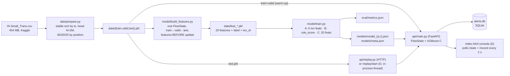

# MuleTrace audit (Phase 1)

Branch `hardening`, cut from `origin/main` at `f3ee1e1`. Audit date 2026-10-17. Nothing in this document was executed against the dataset or the VM; it is a reading of the code, the committed samples and one VM terminal log.

## 0. What was audited, and a finding before everything else

| Source | Where | In git? |
|---|---|---|
| Pipeline: `data/prepare.py`, `model/features.py`, `model/build_features.py`, `model/train.py` | repo | yes |
| API v1: `api/main.py` (139 lines; `/health /system /score /alerts /alerts/{id}/action /graph /stats`) | repo | yes |
| **API v2**: `main.py` (285 lines; adds `/`, `/recent`, `/alerts/{id}`, `/metrics`, `/replay/start`, `/replay/stop`) | `~/Downloads/main.py`, modified 2026-10-17 15:52 | **no** |
| **Console**: `index.html` (485 lines, vis-network from CDN) | `~/Downloads/index.html`, modified 15:52 | **no** |
| `api/replay.py`, `eval/metrics.json`, `samples/*.json`, `README.md`, `model.md`, `docs/api.md` | repo | yes |
| VM terminal log (setup and data download only; it ends before training) | `~/Desktop/muletracker_terminaltxt` | no (and must stay out: it contains the VM IP) |

Commit `1bec61c`, "Full investigator console + upgraded live API", adds only `README.md`. The console and API v2 were never committed. Anyone who clones the repo gets API v1 and no UI. In this document, **(D)** marks line numbers in the uncommitted `~/Downloads` files. Unmarked API line numbers refer to the committed `api/main.py`.

## 1. Actual architecture

**Data flow per payment:** `ts` → minutes since epoch (`tmin`) → `FlowState.features()` (past-only: reads the 60-minute deques, then prunes them) → `FlowState.update()` → a 1-row DataFrame in `meta["features"]` order → `predict_proba` → threshold → decision → reasons → INSERT into `alerts` if not ALLOW.

## 2. Endpoints

| Method | Path | v1 (repo) | v2 (D) | Writes state? |
|---|---|:-:|:-:|---|
| GET | `/` | – | ✓ serves `web/index.html` | no |
| GET | `/health` | ✓ | ✓ (+uptime) | no |
| GET | `/system` | ✓ | ✓ (+cpus, thresholds) | no |
| POST | `/score` | ✓ no validation | ✓ amount>0, fmt, ts | **FlowState + alerts** |
| GET | `/recent` | – | ✓ last 300 decisions | no |
| GET | `/alerts` | ✓ returns `truth` | ✓ hides `truth`; status/decision filters | no |
| GET | `/alerts/{id}` | – | ✓ | no |
| POST | `/alerts/{id}/action` | ✓ confirm/dismiss/escalate | ✓ + `open`, note | **alerts (overwrite)** |
| GET | `/graph/{account}` | ✓ raw deques, 1-hop | ✓ last-60-min, top-N, 1-hop | no |
| GET | `/stats` | ✓ | ✓ + per_sec, by_status, replay | no |
| GET | `/metrics` | – | ✓ serves `eval/metrics.json` | no |
| POST | `/replay/start`, `/replay/stop` | – | ✓ background thread | **FlowState + alerts** |

None of the write endpoints require authentication. CORS is `*` in both versions.

## 3. Where decisions, thresholds and labels are produced

| What | Where |
|---|---|
| Label read from CSV | `data/prepare.py:5-10` (`label` = "Is Laundering") |
| Label carried to features | `model/build_features.py:19` (column next to the features, not inside `ALL_FEATURES`) |
| Per-model evaluation threshold = 99th percentile of **validation** scores | `model/train.py:23` |
| Serving thresholds: `flag_threshold` = 99th pct, `hold_threshold` = 99.8th pct of C's **validation** scores | `model/train.py:41-44` → `models/meta.json` |
| Thresholds loaded by fuzzy key match (`"flag" in key`) | `api/main.py:15-20`, (D) `:20-25` |
| Decision ALLOW / REVIEW / HOLD | `api/main.py:78`, (D) `:84` |
| Rule-based reasons | `model/features.py:82-99` |
| Fallback reasons ("AI risk score…", "Paid by ACH…") | `api/main.py:133-139`, (D) `:64-71` |
| Rule baseline B | `model/features.py:102-108` |
| Ground truth sent to the API | `api/replay.py:10`, (D) `:132` |
| Ground truth stored | `api/main.py:84-85`, (D) `:93-96` (`alerts.truth`) |
| Ground truth returned to clients | `api/main.py:91` (v1 `/alerts`); excluded in (D) `:185` |
| Hard-coded UI numbers | (D) `index.html:249-252` (sample alerts/stats/system/metrics), `:459` ("about 1 in 1,000") |

**Leakage checks that pass on reading:** the split is by position after a stable time sort. Features are computed before `update()`. Thresholds come from validation only. Labels never enter `FlowState`. The API warm-up (train+valid) matches the offline stream state at the start of test. The feature order is stored in `meta.json` and used by the API.

## 4. Defects, ranked

Severity: **Critical** = submission is wrong or not reproducible · **High** = wrong results, a security hole, or a ground-rule violation · **Medium** = real bug with limited blast radius · **Low** = hygiene.

| # | Sev | Area | Defect | Location |
|---|---|---|---|---|
| 1 | Critical | Repo | Console and API v2 exist only in `~/Downloads`. The repo serves API v1 and `/` doesn't exist. `docs/api.md` documents v1. The VM may have yet another copy. | commit `1bec61c`; `~/Downloads/{main.py,index.html}` |
| 2 | High | Correctness | **No guard on timestamp order.** `FlowState` assumes time never goes backwards. A payment with a later `ts` makes `_recent()` permanently `popleft` history the stream still needs. An earlier `ts` lets "future" entries count as past. `pd.Timestamp` also accepts `"now"`. The console's default manual timestamp (2022-09-03 14:31) is about 23 h ahead of the replay stream (starts about 2022-09-02 15:14), so one manual score corrupts features for those accounts and jumps `last_t`, which empties `/graph`. | `model/features.py:26-29`; (D) `main.py:76-81`; (D) `index.html:202` |
| 3 | High | Security | Write endpoints have no authentication, and CORS is `*`. Any web page open in the analyst's browser while the SSH tunnel is up can POST to `localhost:8000`: inject payments (poisoning `FlowState`), change alert status, start or stop the replay. | `api/main.py:11`; (D) `main.py:15,169,217,273` |
| 4 | High | Ground rule | HOLD is presented as an executed action: "stopped before money moves", the toast "Escalated to senior investigator". No `simulated` or `recommendation` field anywhere. | (D) `index.html:125,420`; API responses |
| 5 | High | Honesty | **Silent sample-data fallback.** `/metrics` or `/system` errors (including HTTP 404) show SAMPLE metrics/system with no demo label. The IBM pill hard-codes "IBM z17 · s390x" on failure. Any request slower than 4 s flips the console into DEMO mode. SAMPLE `avg_ms` is 1.46, but `samples/stats.json` says 1.52. | (D) `index.html:250,267,347-351,450,464,475` |
| 6 | High | Governance | No audit trail. Each action overwrites `status` and `note`, `open` re-opens without history, and there's no analyst identity. | (D) `main.py:217-227`; `api/main.py:102-110` |
| 7 | Med-High | Explainability | Reasons aren't tied to the model. When no rule fires, the fallback is "AI risk score N/100, similar to known laundering", or the unverified "Paid by ACH, the payment type most used in known laundering cases". **21 of the 28** sample alerts show only the generic reason. | (D) `main.py:64-71,85`; `samples/alerts.json` |
| 8 | Medium | Reproducibility | `cycle3` iterates `list(dst_receivers)[:20]` over a `set` of strings. Its order depends on `PYTHONHASHSEED`, so offline features, API features and reruns can differ for receivers with more than 20 payees. Verified: the same set printed in a different order in two processes. | `model/features.py:44` |
| 9 | Medium | Validation | `amount` accepts `NaN`/`Infinity` (Pydantic float default; Starlette's JSON parser accepts them). `inf` poisons account state permanently, and the response fails with a 500. Account IDs have no length or charset bound. `currency` isn't validated. There's a broad `except Exception` on `ts`. v1 has no validation at all. | (D) `main.py:105-114,169-179`; `api/main.py:47-56` |
| 10 | Medium | Concurrency | Replay: the check-then-set on `replay["running"]` isn't atomic, so two threads are possible. Stop followed by Start inside one sleep gap is a silent no-op. Replaying test rows twice (CLI `replay.py` plus `/replay/start`, or a restart, since `alerts.db` persists) double-inserts payments into `FlowState`, which inflates fan-in and duplicates alerts. | (D) `main.py:117-140,273-285`; `api/replay.py` |
| 11 | Medium | Leakage risk | Timestamps are minute-resolution, and the order within a minute is CSV order (`prepare.py:14`, stable sort). Features such as `fwd_lag=0` ("received 0 min ago") rely on that order. If the generator writes pattern rows together, the model may be learning an artefact. **Not confirmed.** A robustness run with order shuffled within each minute would settle it. | `data/prepare.py:14`; `model/features.py:49` |
| 12 | Medium | Deploy | No `requirements.txt`. The VM mixes apt packages (pandas 2.1.4, numpy 1.26.4, scikit-learn 1.4.1) with pip packages (xgboost 3.4.1 **built from sdist**, fastapi 0.143.3, pydantic 2.14.1) via `--system-site-packages`. A clean install will differ. | VM log; repo root |
| 13 | Medium | Concurrency | `stats` counters are mutated outside any lock by the replay thread and the request threadpool. v1 writes SQLite from threadpool threads with no lock. There's no WAL mode. | (D) `main.py:88`; `api/main.py:28,81-86` |
| 14 | Medium | Testability | Import-time side effects: loading `models/meta.json`, the model, and replaying 1.6M rows at import. The API can't be tested without the 454 MB dataset, and every restart pays the warm-up. | `api/main.py:13-45`; (D) `:18-62` |
| 15 | Medium | Resources | `FlowState` never evicts inactive accounts, and `seen`, `pairs` and `last_in` grow forever. Fine for a 2M-row demo; unbounded for long streams. | `model/features.py:18-24` |
| 16 | Low | Graph | `/graph` is 1-hop only. The UI fakes 2-hop with two calls capped at 10 edges each. v1 returns raw, unpruned deques (older than 60 min). | `api/main.py:112-125`; (D) `main.py:229-252`, `index.html:397` |
| 17 | Low | Offline demo | vis-network is loaded from cdnjs, so the graph fails without internet. | (D) `index.html:7` |
| 18 | Low | A11y | Alert cards and feed rows are click-only `div`/`tr` with no `tabindex` or key handler. No `aria-live` region for the stream. | (D) `index.html:326-334,369-377` |
| 19 | Low | Portability | `/system` raises a 500 off-Linux (`/proc/cpuinfo`). `data_egress: "none"` is a declared string, not a measurement. | (D) `main.py:158-167` |
| 20 | Low | Docs | `docs/api.md` sends `ts` as an integer (that would fail validation). The action response shape and the "escalated" status are wrong. `latency_ms: 1.4` was never measured. `model.md` "top signals" aren't recorded in any result file. "About 1 in 1,000" in the UI is unverified. | `docs/api.md`; `model.md:41-45`; (D) `index.html:459` |
| 21 | Low | Provenance | `eval/metrics.json` doesn't record N, date range, git SHA, library versions or machine. `train.py` overwrites it. | `model/train.py:48` |
| 22 | Low | Repo | `.gitignore` misses `.venv/`, `*.db-wal`, `*.db-shm`, `.pytest_cache/` and `data/*.zip`. There's no LICENSE, no tests and no scripts. | `.gitignore` |
| 23 | Info | Hygiene (outside repo) | A private-key copy sits in `~/Downloads` and the VM IP is in a Desktop log. The git history scan is clean: no keys, tokens or IPs. | – |

## 5. Facts recovered from the VM log (2026-10-17 session)

- `uname -m` = s390x · `nproc` = 3 · 7.8 GiB RAM, **no swap** · Python 3.12.3 · `nnpa` flag present · `/proc/sysinfo` Type 9175.
- Dataset: `HI-Small_Trans.csv` 454 MB, license CDLA-Sharing-1.0 (per Kaggle CLI).
- `pip install snapml` → snapml 1.17.2 installed, but it warned **"Falling back to CPU-only mode. IBM Snap ML will not leverage NNPA."** This matters for Phase 7.17.
- The log ends before `prepare.py` ran. No training, timing or latency output is recorded in it. The "about 45 s feature build" and "1.46 ms" figures have **no recorded source** in the repo or the log.
